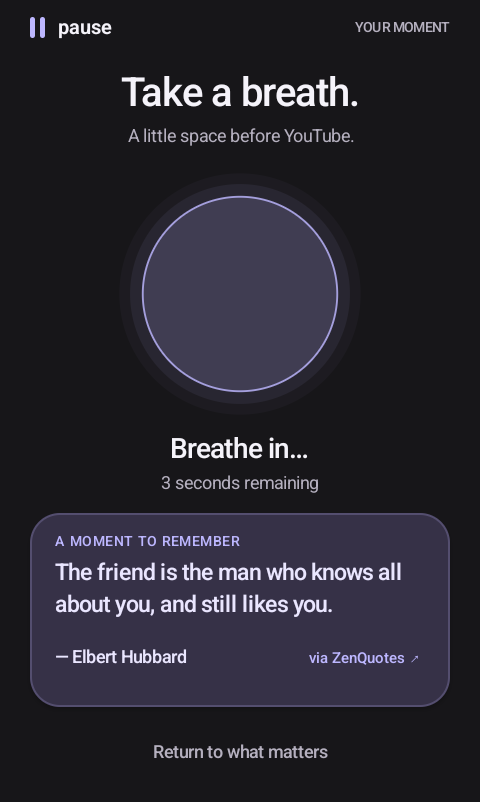
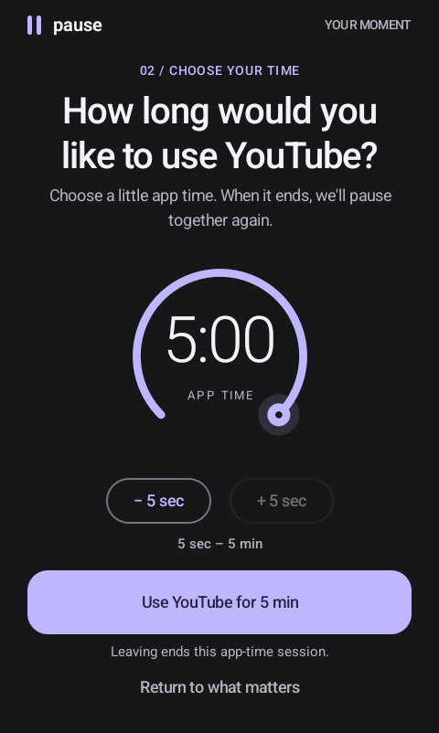
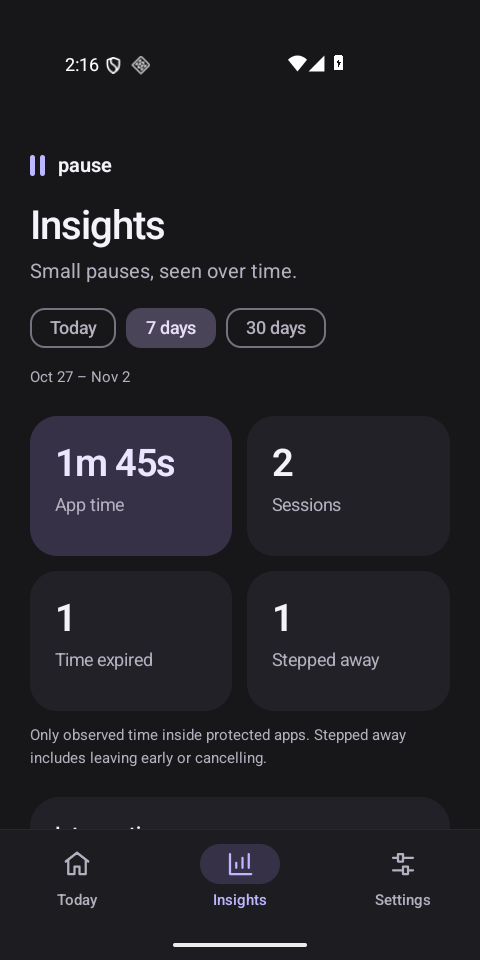

# Pause

### Use the app when you need it. Pause before you don't.

I built Pause because normal app timers were never quite enough.

A daily limit treats every use the same. I might spend my allowance early, then genuinely need YouTube later for a tutorial or Instagram to answer someone. And once I bypassed the limit, the blocker usually stopped helping altogether.

Pause takes a different approach: **make one small, intentional choice every time you open a distracting app.**

**Open app → Breathe → Choose up to 5 minutes → Use it → Pause again**

Instead of deciding how much access you deserve for an entire day, you decide whether the *next few minutes* are worth it.

<p>
  
  
  
</p>

## See Pause in action

<table>
  <tr>
    <td align="center"><strong>Take a breath</strong></td>
    <td align="center"><strong>Choose the next few minutes</strong></td>
    <td align="center"><strong>See the pattern</strong></td>
  </tr>
  <tr>
    <td></td>
    <td></td>
    <td></td>
  </tr>
</table>

*The screenshots use demo activity. The breathing and time-selection screens show YouTube as the protected app.*

## Why another app blocker?

Most screen-time tools ask one big question: **“How long should this app be available today?”**

That decision becomes stale. Your morning use says nothing about whether opening the app tonight is useful, automatic, or something you'll regret. A hard lockout can also be too rigid when you genuinely need the app later.

Pause replaces that one daily decision with a repeatable moment of awareness.

| Typical daily timer | Pause |
| --- | --- |
| One allowance for the whole day | A fresh choice whenever you open the app |
| Locks the app after the daily budget is gone | Allows short sessions when you genuinely need them |
| Bypassing the limit can remove the guardrail | Every new allowance stays capped at five minutes |
| Time can feel abstract | You choose the next session before it begins |
| Focuses on restriction | Builds the habit of noticing and choosing |

Pause doesn't decide whether an app is good or bad. It creates enough space for you to decide *why* you're opening it.

## How it works

1. Choose the apps you want Pause to protect.
2. Opening one starts a short breathing intervention.
3. Choose how long you want to use it, up to five minutes.
4. The allowance begins only when that app is actually on screen.
5. Leaving early discards the unused time.
6. When time expires, Pause returns with another breath and another choice.

You can repeat the loop whenever the app is still useful. There is no single daily lockout and no unlimited pass after one override.

## What you get

- Repeating breathe-and-choose interventions.
- A hard five-minute maximum for each allowance.
- Foreground-only app-time measurement.
- Independent settings for each protected app.
- Configurable breathing rhythm, animation, sound, and haptics.
- Optional offline quotes with authors and source attribution.
- Today and Insights views built from measured sessions.
- Dark, light, and system themes.
- Searchable app selection using installed app names and icons.

## Private by design

Pause has no account, backend, analytics, advertising SDK, or cloud sync. Settings and session history stay on the device, and the app requests no Internet permission.

Pause uses Android Accessibility to observe which app is in the foreground. It is configured not to retrieve window content, so it does not read messages, passwords, screen text, or keystrokes.

## Build and try it

Pause supports Android 10 and newer. You need Android Studio with JDK 21, Android SDK platform 36, and build tools 35.0.0.

Add your Android SDK path to the ignored `local.properties` file:

```properties
sdk.dir=C\:/Android/Sdk
```

Build and install the debug APK:

```powershell
.\gradlew.bat :app:assembleDebug
adb install -r .\app\build\outputs\apk\debug\app-debug.apk
```

Open Pause, accept its permission disclosure, enable the Accessibility service, and choose at least one app to protect.

## Project status

Pause 0.4.0 is an actively developed personal Android project. Automated validation currently runs on an Android 16 emulator; physical-device and manufacturer-specific checks remain tracked separately.

More detail is available in:

- [Technical documentation](docs/TECHNICAL.md)
- [Validation report](docs/VALIDATION.md)
- [Physical-device test matrix](docs/DEVICE_TEST_MATRIX.md)
- [Offline quote sourcing](docs/quotes/README.md)

Built with Kotlin and Jetpack Compose.
